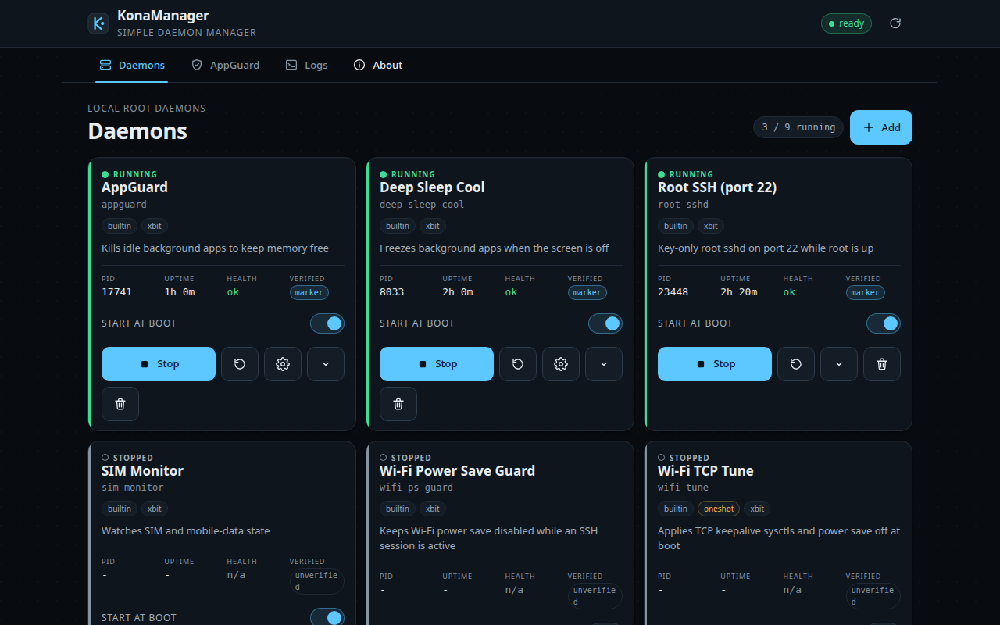

# KonaManager - Simple Daemon Manager

A small KernelSU/ReSukiSU module for managing root daemons on Android, with verified process state, a configurable AppGuard, and a four-tab WebUI.

The module id stays `daemon-manager`, so it can update the existing install in place. All data under `/data/adb/daemon-manager`, the AppGuard lists, `deep-sleep-cool.conf`, and the scripts in `/data/adb/service.d` are preserved.



## What it does

- Lists daemons with state, PID(s), uptime, health, and how the process was verified.
- Start / stop / restart / enable / disable with real verification. Start waits for the process; stop runs the stop command, then TERM, then KILL after the grace period.
- Uses a unique `KM_DAEMON_ID` environment marker plus a pidfile / exact argv check, so a different module running a similar command line is not reported as the daemon.
- AppGuard is fully configurable: per-app user 0 and user 999 switches, per-app kill cooldown, global interval/cooldown, dry-run, editable Never list, package picker, and recent-kill history.
- Install a daemon package from an HTTPS zip, create one from a form, or import an existing `/data/adb/service.d` script. Delete with a plan preview and typed confirmation.
- Logs, doctor, version, and rollback are in the WebUI.
- Phone bottom tab bar, tablet two-column cards, desktop three-column; tested at ten viewports.

## Requirements

- KernelSU, ReSukiSU, APatch, or a Magisk build that provides the module WebUI bridge (`window.ksu.exec`).
- Android root at runtime. The module manages root daemons; the WebUI must be opened from the module manager.
- `unzip`, `sha256sum`, `base64`, and a downloader for URL installs. KernelSU's busybox covers the first three. For URL installs without a pinned sha256, install Termux curl or use a package with a known hash.

## Install / update

1. Download `KonaManager-v2.0.0.zip` from the [Releases](https://github.com/Konaimav2/KonaManager/releases) page.
2. Install it in KernelSU/ReSukiSU as a module update.
3. Reboot or soft reboot when convenient. Running daemons are not restarted by the update.
4. Open the module card, then **WebUI**.

The installer backs up the data tree to `/data/adb/daemon-manager/backups/`, keeps the previous module snapshot for `rollback`, and keeps the old AppGuard script as `rollback/appguard.sh.pre-km`. Nothing is enabled or started automatically.

## WebUI

- **Daemons** - health cards. Details opens the status JSON, meta, and the last log lines. The gear appears for AppGuard and Deep Sleep Cool only.
- **AppGuard** - the global controls, Run once / Dry run once, the user 0 / user 999 target matrix, Never list, and recent kills.
- **Logs** - manager, AppGuard, or any daemon id; 50/100/200 lines; optional auto-refresh.
- **About** - dm version/schema, doctor, project links as selectable text, and rollback.

The page uses a strict CSP: no external assets, no inline scripts or styles, no network requests. All shell commands are built from validated tokens or single-quoted arguments.

## AppGuard

Data lives in `/data/adb/daemon-manager/appguard/`:

- `appguard.conf` - `INTERVAL`, `COOLDOWN`, `DRY`.
- `targets.tsv` - `pkg`, user 0 flag, user 999 flag, optional per-app cooldown.
- `never.list` - one package per line; Never overrides both users.
- `kills.tsv`, `heartbeat`.

Settings apply on the next sweep. If the running AppGuard version differs from the installed one, the UI shows a Restart hint. The v1 script is backed up before v2 replaces it.

## Daemon packages

A package is a zip of at most 5 MiB and 200 entries:

```text
daemon.meta
start.sh
stop.sh                 optional
hooks/install.sh        optional, runs as root after extraction
hooks/uninstall.sh      optional, runs as root on delete
files/...               optional
```

`daemon.meta`:

```ini
schema=1
id=my-daemon
name=My Daemon
desc=What it does
version=1.0.0
kind=daemon
start=start.sh
stop=
stop_scope=marker
start_timeout=8
stop_grace=5
health=proc
hooks.install.sha256=<64 hex>     optional
hooks.uninstall.sha256=<64 hex>   optional
```

Rules: HTTPS only; no absolute paths, `..`, backslashes, symlinks, or devices; ids must match `^[a-z0-9][a-z0-9-]{1,30}$`; a conflicting id is rejected. Hooks are shown in full before the install and must match their pinned hashes. Nothing executes before the typed confirmation.

## CLI

```sh
su -c '/data/adb/modules/daemon-manager/bin/dm list'
su -c '/data/adb/modules/daemon-manager/bin/dm status appguard'
su -c '/data/adb/modules/daemon-manager/bin/dm doctor'
```

Every command prints one JSON object. See `docs/DESIGN.md` and `docs/BACKEND-NOTES.md` for the full contract.

## Development

Backend tests use fixture roots and never touch `/data/adb`:

```sh
sh tests/run.sh
```

UI QA uses a stateful KernelSU mock and Playwright:

```sh
python3 -m pip install playwright
KM_WEBROOT="$PWD/module/webroot" python3 tests/ui/qa.py
```

The QA script measures ten viewports, asserts zero horizontal overflow, exercises AppGuard/install/create/import/delete, and writes `tests/evidence/ui/report.json` plus ten screenshots.

Build the flashable zip:

```sh
sh build/make-zip.sh
```

## Safety notes

- The manager never uses `pkill -f` as its source of truth. It verifies a pid against a pidfile, a unique environment marker, and exact argv before signalling it.
- Builtin daemons keep their existing `service.d` boot scripts and executable-bit enable state. Package/created daemons use a `km-<id>.sh` wrapper.
- Delete removes only the managed daemon folder and its wrapper. Imported service.d scripts are unmanaged, not deleted.
- Stop on `root-sshd` asks for confirmation first; live SSH sessions are not killed by the module.

## License

MIT. See [LICENSE](LICENSE).
